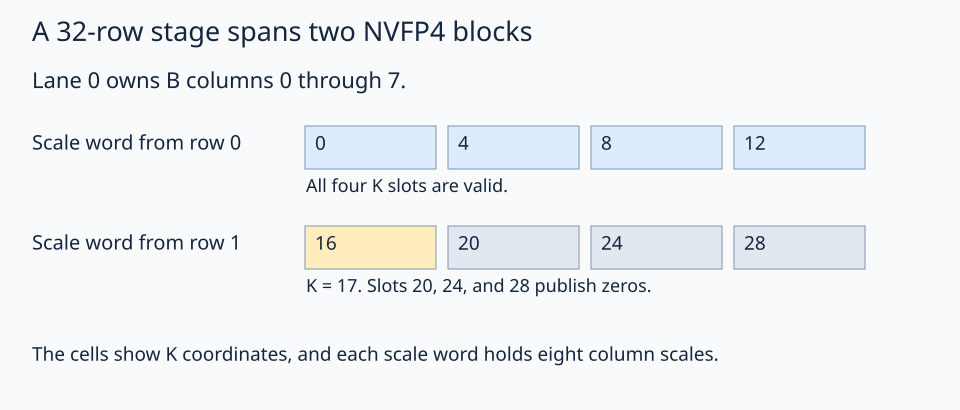

# 14.3.3 · Fuse arithmetic NVFP4 decode into staging

Move dequantization into the B staging step. The lane loads packed weights and E4M3 scale bytes, decodes weights into BF16, and publishes them to LDS for WMMA. Each file includes the full fused kernel and its configuration. [Scalar baseline](../02-scalar-dequant/README.md) · [Stage 15 · Mixed-width edge loads](../../../13-matmul/15-edge-load-widths/README.md)

## One K stage, two scale rows

Trace the same `(M,N,K) = (2,9,17)` example. The default `16×64×32` group tile spans two 16-row NVFP4 blocks. A lane owns up to eight neighboring B columns. In this geometry, the first lane owns columns `0–7` and K rows `0,4,8,12,16,20,24,28` in the tile.



Follow lane 0 from row 12 to row 16. The scale word changes because `row // 16` changes. Every byte in a word belongs to a different N column. `load_b_stage` loads the scale words and packed weight words with separate physical byte limits. Inside `publish_stage`, the lane extracts each nibble and its E4M3 byte, computes the E2M1 and E4M3 values with arithmetic, and multiplies by the FP32 tensor scale. Invalid K rows are cleared before the BF16 tile reaches WMMA.

The LDS path selects FP32 zero for padded K rows after both scale multiplications, then converts the selected values to BF16. Step 04 replaces the E2M1 magnitude arithmetic with a register lookup. [Matched K-tail timings](../../results/README.md#masking-the-quantized-k-tail)

## Where the work changes

Arithmetic staging saves the global BF16 B materialization and a separate decode launch. Each staged value still needs both scales before WMMA. Check the measured shape defaults for end-to-end timings and the selected staging route. [NVFP4 tuning results](../results/README.md)

The tuned gfx1151 defaults took **62.82 µs** at `16×1024×8192`, compared with 111.33 µs for the previous schedule. B uses LDS. The `2×9×17` launcher default uses B through LDS and takes 2.32 µs, compared with 3.01 µs previously. The practice trace supplies its LDS config explicitly so the lane coordinates match the diagram.

## Practice

Fill `b_block_scale` in `publish_stage` in [practice.py](practice.py). Decode the extracted `b_scale_byte` before the two scale multiplications. The expected checkpoint is **`C[0, 1] = 0.75, C[1, 1] = 1.25`**. The checker also covers full and partial tiles, both A staging paths, and split-K. [Worked solution](solution.py)

```bash
pixi run python lessons/01-gpu-programming/14-quantized-matmul/03-nvfp4-w4a16/03-fused-staging/practice.py
pixi run python lessons/01-gpu-programming/14-quantized-matmul/03-nvfp4-w4a16/03-fused-staging/solution.py
```

## Revision question

Why does one K stage use two scale words per lane in this example?

<details><summary>Answer</summary>

The 32-row stage spans two NVFP4 blocks. Lane 0 owns four K slots in each block. The eight column scales for its first four K slots come from scale row 0, and its remaining slots use scale row 1. K padding contributes zero.

</details>

[Previous · Scalar dequantization](../02-scalar-dequant/README.md) · [NVFP4 W4A16](../README.md) · [Next · Register lookup](../04-lut-decode/README.md)
