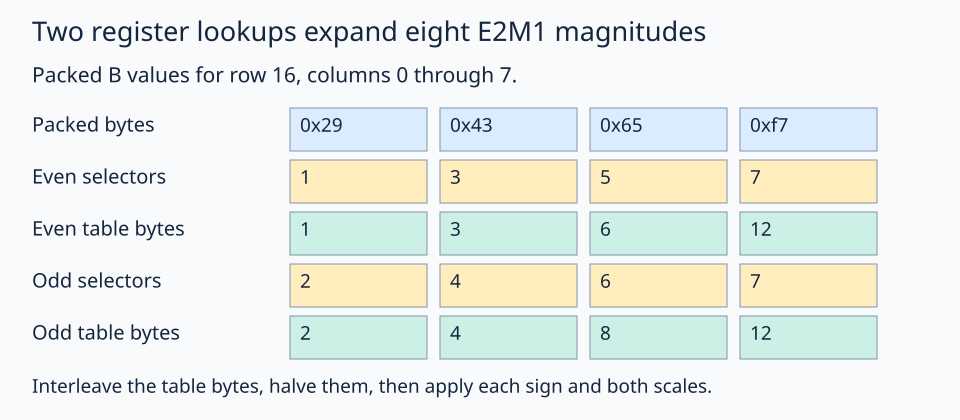

# 14.3.4 · Decode eight NVFP4 nibbles with a register lookup

NVFP4 uses the same eight magnitudes as MXFP4. Two `perm_b32` lookups return bits 29:22 of each FP32 magnitude. The original code supplies the sign and top exponent bit. Assemble the E4M3 block scale's exponent and fraction in FP32, then apply the block scale and tensor multiplier in order. [MXFP4 register lookup](../../01-mxfp4-w4a16/04-lut-decode/README.md)

## Follow eight weights in row 16

The first eight columns use packed bytes `[0x29, 0x43, 0x65, 0xf7]` in address order. Mask the low three bits of each low nibble to get even selectors `[1, 3, 5, 7]`. Shift the word by four bits and apply the same mask to get odd selectors `[2, 4, 6, 7]`.



Follow column 1. Its code is the first odd nibble, `0x2`. The table returns `0xfe`. Shift it left by 22 and add the sign and top exponent bit from the original nibble to get `0x3f800000`, FP32 1. For this column, the two scale multiplications are `1 × 1.5 × 0.5 = 0.75`.

## Where the work changes

The lookup replaces magnitude arithmetic with two register permutations per chunk. It still applies the E4M3 block scale and FP32 tensor scale to each decoded weight. Check the measured shape defaults for end-to-end timings and the selected staging route. [NVFP4 tuning results](../results/README.md)

The earlier tuned gfx1151 defaults took **53.66 µs** at `16×1024×8192`, compared with 82.54 µs for the previous schedule. B uses LDS. The `2×9×17` launcher default uses B through registers and takes 2.16 µs, compared with 2.84 µs previously. The practice trace supplies its LDS config explicitly so the lane coordinates match the diagram.

## Matched decoder update

On Radeon 8060S (gfx1151), the FP32-bit lookup and E4M3 scale expansion were timed against the earlier decoder at the same launch settings. Times are medians of 11 batches of 40 graph replays with 16 matmuls per graph.

| Shape (M,N,K) | Earlier LUT (µs) | FP32-bit LUT (µs) | Latency change |
| --- | ---: | ---: | ---: |
| (16, 1024, 8192) | 53.68 | 49.35 | -8.1% |
| (16, 4096, 8192) | 145.94 | 135.12 | -7.4% |
| (31, 1025, 8193) | 98.78 | 88.13 | -10.8% |
| (2, 9, 17) | 2.09 | 2.07 | -0.7% |

## Practice

Fill `even_codes` in `_lookup_e2m1_magnitudes` in [practice.py](practice.py). Keep three magnitude bits in each byte's low nibble. The expected output checkpoint is **`C[0, 1] = 0.75, C[1, 1] = 1.25`**. [Worked solution](solution.py)

```bash
pixi run python lessons/01-gpu-programming/14-quantized-matmul/03-nvfp4-w4a16/04-lut-decode/practice.py
pixi run python lessons/01-gpu-programming/14-quantized-matmul/03-nvfp4-w4a16/04-lut-decode/solution.py
```

## Performance progression

1. **Decode E4M3 scales once per owned block and column.** Reuse the decoded values across the K slots that share them. [Step 05 · Reuse decoded scales](../05-scale-reuse/README.md)
2. **Tune the staging schedule for 16-row blocks.** Compare K stage depths of 16, 32, and 64 along with tile geometry and split-K. Time the same packed inputs and include small, skinny, and odd-width shapes.
3. **Compare a native block-scaled FP4 path on supporting hardware.** This would require a separate operand layout and a compatible representation for A. Include any A conversion or packing in the end-to-end comparison. [NVIDIA cuDNN NVFP4 conversion and layout](https://docs.nvidia.com/deeplearning/cudnn/latest/operations/BlockScaling/nvfp4_block_scale_conversion)

## Revision question

Why do columns 6 and 7 have the same lookup byte and different decoded weights?

<details><summary>Answer</summary>

Their codes are `0x7` and `0xf`. Each has magnitude selector 7, so each lookup returns `0x03`. Both codes supply the same top exponent bit. The sign bit in `0xf` gives −6, while `0x7` gives +6 before scaling.

</details>

[Previous · Fused arithmetic decode](../03-fused-staging/README.md) · [NVFP4 W4A16](../README.md) · [Next · Reuse decoded scales](../05-scale-reuse/README.md)
