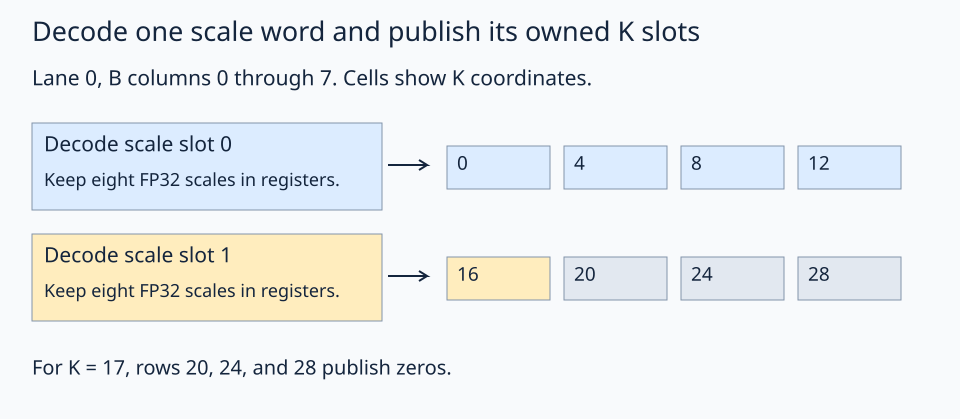

# 14.3.5 · Reuse decoded NVFP4 scales

Step 04 reuses each packed E4M3 scale word but converts its bytes inside the weight loop. Decode the eight scale bytes once for each lane-owned scale slot. Keep those FP32 values live while publishing the rows that share them. [Step 04 · Register lookup](../04-lut-decode/README.md)

## Follow the first lane

Use the same `(M,N,K) = (2,9,17)` example and `16×64×32` group tile. Lane 0 owns B columns `0–7` and eight K positions. The first four positions use scale row 0 and the next four use scale row 1.



Follow column 1 from the second scale word. The byte `0x3c` decodes to FP32 `1.5` and is stored in `b_decoded_scales[1]`. The first row slot in this group is `1 * 4 + 0 = 4`, and its K coordinate is `0 + 4 * 4 = 16`. The FP4 lookup gives 1 for `B[16,1]`, so the result before BF16 conversion is `(1 × 1.5) × 0.5 = 0.75`. Slots for K rows 20, 24, and 28 publish zeros.

In `publish_stage`, the outer loop selects a scale word and fills `b_decoded_scales`. The inner loop publishes the rows that use it. Each row reconstructs signed FP32 weights from the lookup bytes and multiplies by the decoded block scale and tensor scale in that order. The next scale slot overwrites the same eight FP32 values.

For this geometry, the source describes 16 E4M3 conversions per lane per stage. Step 04 describes 64. Generated instructions can differ because the compiler can eliminate repeated work.

## Practice

Fill `row_slot` in [practice.py](practice.py). Map the pair `(scale_slot, row_in_scale)` to the index in `b_packed_fragment` using `ROW_SLOTS_PER_SCALE`. The expected checkpoint is **`C[0, 1] = 0.75, C[1, 1] = 1.25`**. The checker covers partial tiles, split-K, both A staging paths, and a geometry with one owned row per scale slot. [Worked solution](solution.py)

```bash
pixi run python lessons/01-gpu-programming/14-quantized-matmul/03-nvfp4-w4a16/05-scale-reuse/practice.py
pixi run python lessons/01-gpu-programming/14-quantized-matmul/03-nvfp4-w4a16/05-scale-reuse/solution.py
```

## Where the work changes

Scale reuse saves repeat E4M3 conversions when several owned K rows share a scale slot. The eight FP32 scales stay live for the whole slot. Check the measured shape defaults for end-to-end timings and the selected staging route. [NVFP4 tuning results](../results/README.md)

The earlier tuned gfx1151 defaults took **51.97 µs** at `16×1024×8192`, compared with 83.45 µs for the previous schedule. B uses LDS. The `2×9×17` launcher default uses B through registers and takes 2.15 µs, compared with 2.84 µs previously. The practice trace supplies its LDS config explicitly so the lane coordinates match the diagram.

## Matched decoder update

On Radeon 8060S (gfx1151), the FP32-bit lookup and E4M3 scale expansion were timed against the earlier decoder at the same launch settings. Times are medians of 11 batches of 40 graph replays with 16 matmuls per graph.

| Shape (M,N,K) | Earlier LUT (µs) | FP32-bit LUT (µs) | Latency change |
| --- | ---: | ---: | ---: |
| (16, 1024, 8192) | 52.08 | 49.49 | -5.0% |
| (16, 4096, 8192) | 146.13 | 134.97 | -7.6% |
| (31, 1025, 8193) | 87.96 | 81.98 | -6.8% |
| (2, 9, 17) | 2.09 | 2.07 | -1.3% |

## Compare at fixed geometry

Both paths use the same tile, waves, cache policy, split count, and packed inputs. The comparison checks the CPU reference and output sentinel and replays each graph with changed weights. [Measured results](results/README.md)

In the earlier doubled-magnitude implementation on Radeon 8060S at `31×1025×8193`, reuse took 132.17 µs versus 225.23 µs for the LUT-only path at matched geometry. The generated kernel shows 48 static scale-decode sites versus 144 and uses 32 more VGPRs. The aligned `16×1024×8192` shape has identical scale-decode site counts and effectively flat latency. The separately tuned defaults answer a different question, which schedule to use for each shape.

```bash
pixi run python lessons/01-gpu-programming/14-quantized-matmul/03-nvfp4-w4a16/05-scale-reuse/compare.py \
  --output /tmp/nvfp4-scale-reuse.json
```

## Revision question

What reuse remains if a lane owns only one K row per scale slot?

<details><summary>Answer</summary>

Each decoded scale value is used once for that lane's row and column. That geometry gives the source no cross-row reuse, though each scale word still supplies eight columns.

</details>

[Previous · Register lookup](../04-lut-decode/README.md) · [NVFP4 W4A16](../README.md) · [Quantized matmul](../../README.md)
