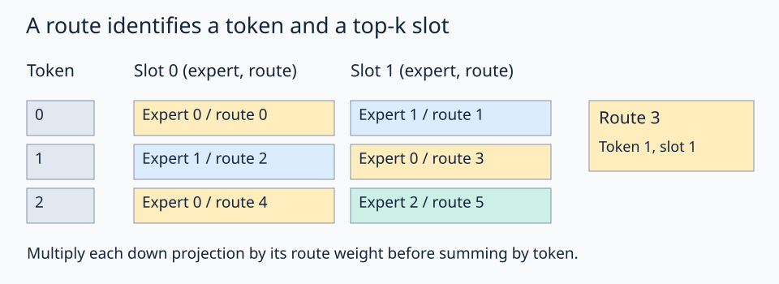

# 00 · Run one expert per route

A token can use several experts. Each top-k slot selects an expert and gives its output a weight. Start with one logical row per `(token, slot)` so that every route has a unique place to store its result. The final kernel owns the output by token and gathers the route rows.



## Trace route 3

The example uses three one-value tokens `[1, 2, 3]`, four experts, and top-2 routing. Flattening the routing array gives expert IDs `[0, 1, 1, 0, 0, 2]`. Route 3 corresponds to token 1, slot 1, and expert 0.

```python
token = route // TOP_K
expert = ids[route]
x_row = fx.slice(x, (token, None))
expert_weights = fx.slice(w_gate_up, (expert, None, None))
```

The kernel divides the output identity layout into `(1, 128)` tiles, slices the current block, and indexes that coordinate view by thread ID. The selected coordinate gives one route and one output channel. Gate and up are FP32 dot products over the same input row. For route 3 the dots give gate `2` and up `4`. The kernel writes `BF16(silu(2) * 4) = 7.03125` to the activation row for route 3.

The down projection reads that row and expert 0's down weight `1`. The combine thread for token 1 reads routes 2 and 3, applies weights `0.25` and `0.75`, and stores `BF16(0 + 0.75 * 7.03125) = 5.28125`. The full checkpoint is `[0.73046875, 5.28125, 4.28125]`.

## Practice

Fill in `token` in the gate/up kernel. The checker compares every output against per-expert FP32 Torch arithmetic with the same BF16 rounding points. It also covers odd channel widths, empty experts, invalid routes, and preallocated output bounds.

```bash
pixi run python lessons/01-gpu-programming/15-bf16-moe/00-naive/practice.py
pixi run python lessons/01-gpu-programming/15-bf16-moe/00-naive/solution.py
```

The starter prints `Practice not finished` until the expression is filled. The [solution](solution.py) prints `Exercise passed` and the output column.

## Revision question

How does the combine kernel find the two contributions for token 2?

<details><summary>Answer</summary>

Use `route = token * TOP_K + slot`. Token 2 owns routes 4 and 5, with expert IDs 0 and 2. The combine kernel uses those same route indices for the FP32 scratch and routing weights.

</details>

[Lesson index](../README.md) · [Next · Grouped WMMA](../01-grouped-wmma/README.md)
