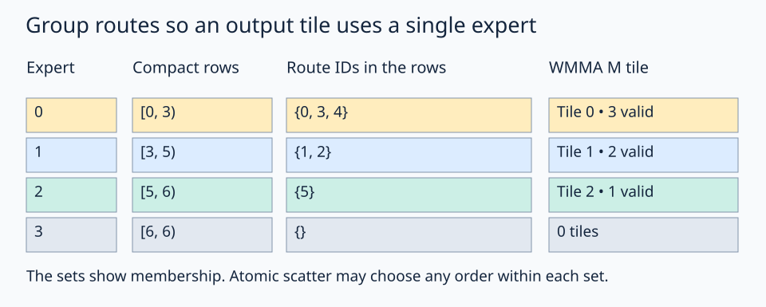

# 01 · Group routes into expert WMMA tiles

Several tokens can select the same expert. Put those routes in neighboring rows so a WMMA tile uses one expert's weights for all its valid rows. This adds GPU worklist construction and lets each projection share its B tile across routes.



## Build the worklist on the GPU

For the [three-token example](../00-naive/README.md), the expert loads are `[3, 2, 1, 0]`. A histogram counts routes, an exclusive prefix sum assigns each expert a compact row range and a tile range, and atomic scatter fills `sorted_ids` with original route IDs. Expert 0's rows `[0, 3)` contain routes 0, 3, and 4 in an order chosen by scatter.

Each tile descriptor holds its expert, compact start row, valid row count, and the bounds of the expert's tile run. Tile 0 has 3 valid rows out of 16, so 13 A rows load zeros and skip stores. The launch grid uses a capacity derived from `T * top_k` and `E`. Workgroups test the actual tile count on the device, which lets the graph replay with changed routing values.

## Feed both projections

Gate/up gathers `x[sorted_ids[start + row] // TOP_K]`. For B, slice the expert axis, divide its weight view into projection halves, then divide each half into K/N tiles. The slices retain the original row stride of the packed weights.

Build separate `fx.make_layout_tv` plans for contiguous K chunks of A and N chunks of B. In the aligned default `16×32×32` tile, A's thread layout is `(16, 4):(4, 1)` and its value layout is `(1, 8)`. Thread 5 owns row 1 and K positions 8–15. Partition both the A LDS view and its identity coordinate view with that plan. The coordinate gives the compact row to gather and the K position inside the selected token row. For B, partition the selected global tile with the same plan used by its LDS destination.

The launcher selects the widest aligned 128-, 64-, 32-, or 16-bit copy for each operand. Out-of-range rows and K/N coordinates stay zero. WMMA copy plans read 16 K values at a time from padded LDS. With prefetch enabled, the next global stage loads into registers while WMMA consumes the current LDS stage.

Gate/up stores FP32 projection pairs in compact row order. The activation kernel keeps that order, giving down projection contiguous BF16 rows. Down converts each compact row back into the original route ID, so the final reduction still follows top-k slot order. The optional M traversal groups neighboring row tiles at a fixed output column **within one expert**. A short final group uses its actual height to decode the block ID. [BF16 WMMA staging and tails](../../13-matmul/15-edge-load-widths/README.md)

## Practice

Fill in `route` in the grouped down epilogue. The checker validates the output column from the naive stage, the worklist's counts and route coverage, and a skewed case that exercises a short final M traversal group.

```bash
pixi run python lessons/01-gpu-programming/15-bf16-moe/01-grouped-wmma/practice.py
pixi run python lessons/01-gpu-programming/15-bf16-moe/01-grouped-wmma/solution.py
```

The starter reports `Practice not finished` until the route expression is filled. The [solution](solution.py) prints `Exercise passed` with the full checkpoint.

## Revision question

Why can two launches scatter the routes in different orders and still produce the same token sums?

<details><summary>Answer</summary>

Both projections follow the worklist built for that launch. Down projection writes to the original route ID, and the final kernel reads each contribution in the same top-k slot order.

</details>

[Previous · Naive MoE](../00-naive/README.md) · [Next · Fused MoE](../02-fused/README.md)
