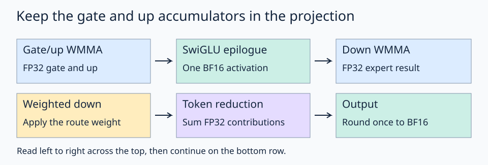

# 02 · Fuse expert projection epilogues

Each gate/up workgroup already holds two FP32 accumulators for matching output positions. Apply SwiGLU there and store the BF16 activation that down projection consumes. This removes the FP32 gate/up scratch, its write and read, and the standalone activation launch.



## Follow the weighted down contribution

For route 0 in the [trace example](../00-naive/README.md), the down accumulator is `1.4609375`. Its routing weight is `0.5`. The epilogue multiplies in FP32 and stores `0.73046875` in route slot 0. The final kernel sums the preweighted FP32 slots and rounds to BF16.

The `atomic=True` path scatters weighted FP32 contributions directly into a cleared `[T,H]` accumulator. A final kernel converts that accumulator to BF16. This reduces scratch from `[T * top_k,H]` to `[T,H]`. Atomics introduce contention between routes for the same token, and their arrival order can vary across launches. The default path preserves the explicit top-k sum order.

## Choose a path for sparse decode

A workgroup in the direct GEMV path handles one route and a slice of output channels. Decode the thread ID with the `(wave, K lane, column)` layout. With four K lanes and eight columns per wave, thread 11 owns K lane 1 and column 3 of wave 0. The divided A and B views give it K positions 1, 5, 9, and so on. XOR shuffles join the four partial dots for that column. The path uses the same fused arithmetic without building an expert worklist. `dispatch="direct-wmma"` provides a one-route-per-tile comparison. The graph-safe `auto` dispatch uses the input dimensions. At up to half as many routes as experts, it chooses GEMV when both projection widths are at most 512 and direct WMMA for wider projections. It chooses grouped WMMA as the route count grows. Use `dispatch="grouped"` to compare a workload's actual route distribution. [gfx1151 measurements](../results/README.md)

## Practice

Fill in `value` in the slot reduction. Use the current route ID and output channel to read the contribution that already includes the routing weight.

```bash
pixi run python lessons/01-gpu-programming/15-bf16-moe/02-fused/practice.py
pixi run python lessons/01-gpu-programming/15-bf16-moe/02-fused/solution.py
```

The starter reports `Practice not finished` until the read is filled. The [solution](solution.py) checks grouped, direct WMMA, GEMV, and atomic variants and prints the same output column as the naive stage.

## Revision question

Why does the atomic path clear an FP32 buffer before the down projection?

<details><summary>Answer</summary>

The down workgroups add their route contributions to the current accumulator. Starting at zero makes the buffer contain exactly the sum for the current launch, including zero for tokens with no valid routes.

</details>

[Previous · Grouped WMMA](../01-grouped-wmma/README.md) · [Lesson index](../README.md)
