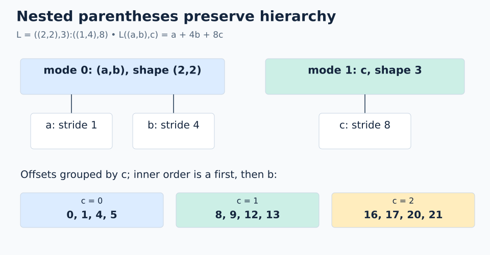

# 02 · Nested layouts

**Mental model:** parentheses preserve hierarchy. One top-level mode can contain its own smaller coordinate system.

```text
L = ((2,2),3):((1,4),8)
coordinate = ((a,b),c)
L((a,b),c) = a + 4*b + 8*c
```

There are two top-level modes: `(2,2)` and `3`. Total size is `2*2*3 = 12`. There are three leaf axes, but the top-level rank is 2.



## Worked example

For `((1,1),2)`, the offset is `1 + 4 + 16 = 21`.

A scalar coordinate still expands first-mode-fastest. First split into the top-level sizes `(4,3)`, then split the first coordinate into `(2,2)`:

```text
q = 7
top-level: (7 % 4, 7 // 4) = (3,1)
inner:     (3 % 2, 3 // 2) = (1,1)
coordinate: ((1,1),1)
offset: 1 + 4 + 8 = 13
```

## Flattening structure versus coalescing

Writing `(2,2,3):(1,4,8)` removes the grouping while keeping the same leaf order and scalar-coordinate mapping. It does not guarantee a single mode: the sequence has gaps.

Nested modes become useful names for levels such as `(value-within-thread, thread)` or `(position-within-tile, tile-number)`. The algebra does not assign those meanings automatically; we choose them.

```python
# Inside a FlyDSL tracing context
layout = fx.make_layout(((2, 2), 3), ((1, 4), 8))
offset = fx.crd2idx(fx.make_coord((1, 1), 2), layout)  # 21
```

**Trap:** matching shape and stride trees matters. `((2,2),3)` pairs with `((1,4),8)`, not the differently nested `(1,(4,8))`.

**Check yourself:** what are the size, rank, and offset of `((0,1),1)`?

<details><summary>Answer</summary>

Size 12, rank 2, offset 12.

</details>

[← Coordinates and views](01-coordinates-and-views.md) · [Next: composition →](03-composition.md)
