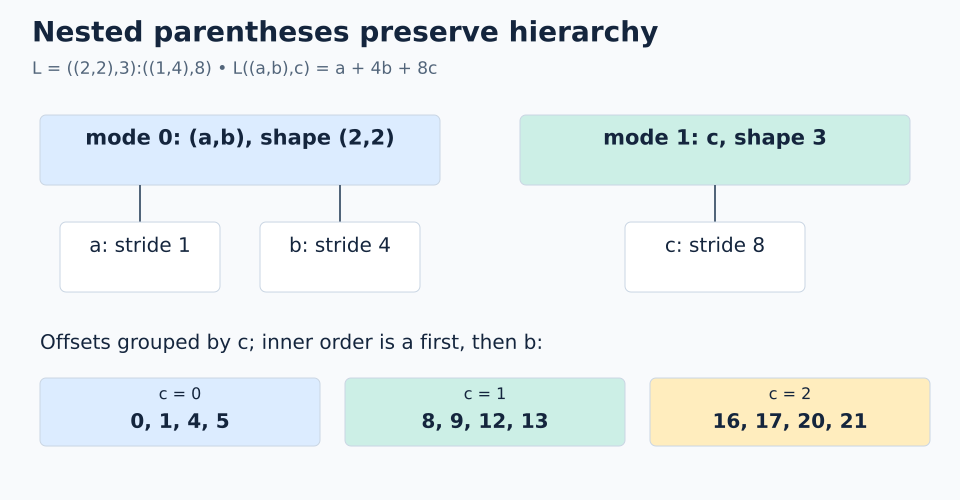

# 02 · Nested layouts

**Mental model:** parentheses preserve hierarchy. One top-level mode can contain its own smaller coordinate system.

```text
L = ((2,2),3):((1,4),8)
coordinate = ((a,b),c)
L((a,b),c) = a + 4*b + 8*c
```

There are two top-level modes: `(2,2)` and `3`. Total size is `2*2*3 = 12`. There are three leaf axes, but the top-level rank is 2.



## Worked example

For `((1,1),2)`, the offset is `1 + 4 + 16 = 21`.

A scalar coordinate still expands first-mode-fastest. First split into the top-level sizes `(4,3)`, then split the first coordinate into `(2,2)`:

```text
q = 7
top-level: (7 % 4, 7 // 4) = (3,1)
inner:     (3 % 2, 3 // 2) = (1,1)
coordinate: ((1,1),1)
offset: 1 + 4 + 8 = 13
```

## Flattening structure versus coalescing

Writing `(2,2,3):(1,4,8)` removes the grouping while keeping the same leaf order and scalar-coordinate mapping. It does not guarantee a single mode: the sequence has gaps.

Nested modes become useful names for levels such as `(value-within-thread, thread)` or `(position-within-tile, tile-number)`. The algebra does not assign those meanings automatically; we choose them.

```python
# Inside a FlyDSL tracing context
layout = fx.make_layout(((2, 2), 3), ((1, 4), 8))
offset = fx.crd2idx(fx.make_coord((1, 1), 2), layout)  # 21
```

**Trap:** matching shape and stride trees matters. `((2,2),3)` pairs with `((1,4),8)`, not the differently nested `(1,(4,8))`.

**Check yourself:** what are the size, rank, and offset of `((0,1),1)`?

<details><summary>Answer</summary>

Size 12, rank 2, offset 12.

</details>

## Practice

### Goal and starting data

Use **`L = ((2,2),3):((1,4),8)`** and scalar logical coordinate **`q=7`**. Return its logical size, the fully expanded coordinate, and the resulting memory offset.

Open [`practice.py`](practice.py). The nested `Layout` and `q` are provided. Replace the three `None` values; keep the shape and stride parentheses as given. The local [`layout.py`](layout.py) supplies `size(shape)`, `expand(q, shape)`, and the callable `Layout` object.

### Complete `solve()`

1. Draw the shape tree: top-level mode 0 has shape `(2,2)` and size 4; top-level mode 1 has shape `3`. Set `logical_size` with `size(layout.shape)`, which multiplies **all leaf sizes**. `len(layout.shape)` counts top-level modes instead.
2. Split `q=7` by the size of the first top-level mode: the remainder locates a position within that size-4 mode, and the quotient selects the size-3 mode.
3. Split the remainder again through `(2,2)`. Set `coordinate` using `expand(q, layout.shape)` and compare it with your manual expansion. Its structure must be `((a,b),c)`.
4. Set `memory_offset` by calling `layout(coordinate)`. Independently check it with `a*1 + b*4 + c*8`.
5. Return `(logical_size, coordinate, memory_offset)` using the provided statement. The middle entry is a nested tuple, not a flattened triple.

For a separate checkpoint, `q=4` expands to `((0,0),1)` and maps to offset 8. This lets you check that the inner size-4 mode resets when the outer mode advances.

### Run and check

From the repository root:

```bash
python3 lessons/02-nested-layouts/practice.py
python3 lessons/02-nested-layouts/solution.py
```

From this lesson directory, use `python3 practice.py` and `python3 solution.py`. The initial `Practice not finished: ...` message points to the TODO values. A completed exercise prints `Exercise passed: (12, ((1, 1), 1), 13)`. Compare against the commented [worked solution](solution.py) after your attempt.

A `coordinate/stride tree mismatch` error usually means you passed `(a,b,c)` instead of `((a,b),c)`. An answer of 2 for size confuses rank with the number of positions. An offset of 7 treats the scalar coordinate as a memory offset.

### Try another case

Use scratch code so the required checker stays unchanged:

- Trace `q=8` by hand, then confirm its expanded coordinate and offset with the helpers.
- Construct `Layout((2,2,3), (1,4,8))`. Compare its `.sequence()` with the nested layout's sequence. Why do the sequences match even though the explicit tuple coordinates have different structures?

[← Coordinates and views](../01-coordinates-and-views/README.md) · [Next: composition →](../03-composition/README.md)
