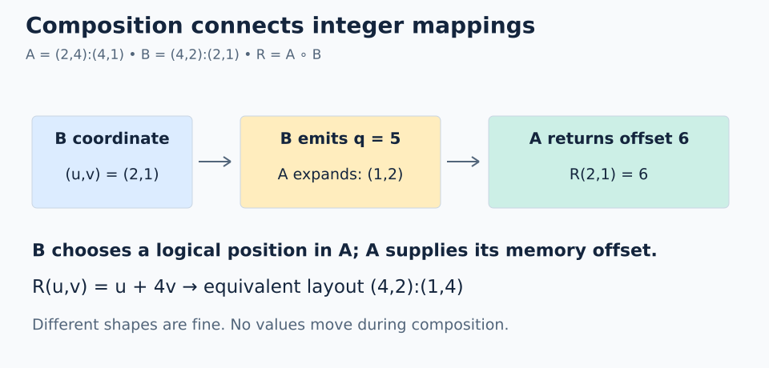

# 03 · Composition: indexing a layout

**Mental model from our discussion:** A describes a data view; B describes how we want to index that view. A GPU thread/value plan is one later use of B.

```text
R = composition(A,B)
R(c) = A(B(c))
```

B runs first. Its output is a **scalar logical coordinate for A**, not a physical address to dereference.

## Different shapes work

Use `A = (2,4):(4,1)` and `B = (4,2):(2,1)`. These retain the `(2,4)` versus `(4,2)` shape contrast from our discussion.



Let B's coordinate be `(u,v)`:

```text
q = B(u,v) = 2*u + v
A(q) = (q % 2)*4 + (q // 2)
     = 4*v + u                # 0 <= v < 2
R = (4,2):(1,4)
```

| B coordinate | B output `q` | A coordinate | Final offset |
| --- | --- | --- | --- |
| `(0,0)` | 0 | `(0,0)` | 0 |
| `(1,0)` | 2 | `(0,1)` | 1 |
| `(0,1)` | 1 | `(1,0)` | 4 |
| `(2,1)` | 5 | `(1,2)` | 6 |
| `(3,1)` | 7 | `(1,3)` | 7 |

The shapes do not need to match: B emits integers that A knows how to interpret.

```python
# Inside a FlyDSL tracing context
A = fx.make_layout((2, 4), (4, 1))
B = fx.make_layout((4, 2), (2, 1))
R = fx.composition(A, B)  # equivalent mapping to (4,2):(1,4)
```

## Must B cover all of A?

**No.** For example, `B_small = 2:2` emits only `0,2`. Passing those through A gives offsets `0,1`: a valid subset of the eight logical positions.

For an in-bounds view, every emitted B index must lie in A's logical domain (`0 <= B(c) < size(A)` in these scalar examples). Full coverage is a separate requirement if the application needs every element. Also, the composition must meet the algebra/compiler's representability and divisibility constraints; matching sizes or checking bounds alone does not prove every arbitrary pair will compile.

Use **A's logical size**, not its physical cosize, to reason about this intermediate coordinate.

## Composition with a nested A

Take `A = ((2,2),3):((1,4),8)` from lesson 02 and `B = (2,3):(2,4)`.

```text
B(u,v) = 2*u + 4*v
A expands this q to ((0,u),v)
R(u,v) = 4*u + 8*v
R is equivalent to (2,3):(4,8)
```

For `(u,v)=(1,2)`: B emits 10, A interprets `((0,1),2)`, final offset 20. The nested grouping introduces no data movement.

**Trap:** multiplying A and B strides component by component does not compute composition. The intermediate scalar coordinate must be interpreted through A's shape.

**Check yourself:** in the first example, compute `R(3,0)` and explain why B does not need shape `(2,4)`.

<details><summary>Answer</summary>

B emits 6; A expands it to `(0,3)` and returns offset 3. Composition connects the integer mappings, not matching axis names.

</details>

## Practice

### Goal and starting data

Evaluate **`A(B(q))`** for every scalar logical coordinate of **`B = (4,2):(2,1)`**, using **`A = (2,4):(4,1)`**. Return only the final offsets, ordered by `q=0..7`.

Open [`practice.py`](practice.py). Both layouts, the loop, intermediate checks, and the output list are provided. Replace the two `None` values. The local [`layout.py`](layout.py) supports layout evaluation and `size(shape)`; it has no symbolic `composition` function to implement or call.

### Complete `solve()`

1. Trace `q=1` before coding. B expands it to `(1,0)`, emits `1*2 + 0*1 = 2`, and A then expands **2** to `(0,1)`, giving final offset 1.
2. Set `intermediate` by applying `b` to the loop variable `q`. B runs first. B's output becomes A's **scalar logical coordinate**.
3. Keep the supplied check `0 <= intermediate < size(a.shape)`. All B outputs must fit A's logical domain; A's storage span is not the bound for this intermediate number.
4. Set `final_offset` by applying `a` to `intermediate`.
5. Keep the append and return statements. Return a **list of eight integers** in B's scalar-coordinate order. Do not return intermediate indices or coordinate tuples.

For debugging, temporarily print `(q, intermediate, final_offset)` inside the loop. The first two triples should be `(0,0,0)` and `(1,2,1)`. Checking the intermediate stage matters here because the final sequence happens to be `0..7`.

### Run and check

From the repository root:

```bash
python3 lessons/03-composition/practice.py
python3 lessons/03-composition/solution.py
```

From this lesson directory, use `python3 practice.py` and `python3 solution.py`. Initially the file reports `Practice not finished: ...`. After filling in both TODOs, expect `Exercise passed: [0, 1, 2, 3, 4, 5, 6, 7]`. Compare with the commented [worked solution](solution.py) after your attempt.

If your result begins `0,2,4,6`, you may be returning B's outputs before passing them through A. The order is `a(b(q))`. Componentwise stride multiplication does not perform A's scalar-coordinate expansion. This particular pair also makes `b(a(q))` return `0..7`, so the starter checks B's intermediate outputs as well. An `apply B first` assertion means that stage is wrong even if your final list would have matched.

### Try another case

Use scratch code so the required checker stays unchanged:

- Replace B with `Layout(2, 2)` and loop over its two coordinates. Trace both stages: this should select a subset of A rather than cover every position.
- Use `a = Layout(((2,2),3), ((1,4),8))` and `b = Layout((2,3), (2,4))`. Trace every coordinate of B. Compare the composed offsets against `Layout((2,3), (4,8)).sequence()`. This case also helps reveal a reversed composition order.

[← Nested layouts](../02-nested-layouts/README.md) · [Next: coalescing →](../04-coalescing/README.md)
