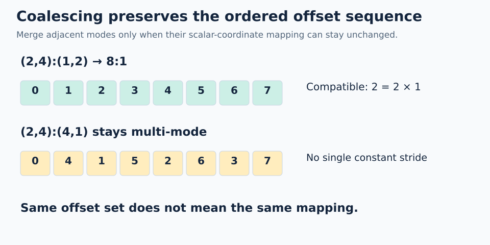

# 04 · Coalescing: simplify the blueprint

**Mental model from our discussion:** like flattening an indexing blueprint while preserving the offset sequence. No tensor values move. Unlike NumPy's `flatten()`, this operation does not copy array data.

For valid **scalar logical coordinates** q, coalescing preserves:

```text
coalesced(q) = original(q)
size(coalesced) = size(original)
```

The coordinate tree may change. An old nested tuple coordinate is not necessarily valid for the result.



## When can two adjacent leaf modes merge?

For `(s0,s1):(d0,d1)`, if `d1 = s0*d0`, they become `(s0*s1):d0`. A statically known size-1 mode can also disappear because its coordinate is always zero.

| Original | Result | Reason |
| --- | --- | --- |
| `(2,4):(1,2)` | `8:1` | `2 = 2*1` |
| `(2,3):(2,4)` | `6:2` | `4 = 2*2`; contiguous bytes are not required |
| `((2,1),4):((1,99),2)` | `8:1` | Remove size-1 mode, then merge |
| `(2,4):(4,1)` | remains multi-mode | `1 != 2*4` |

## Worked non-example

`(2,4):(4,1)` visits offsets `0,4,1,5,2,6,3,7` in scalar-coordinate order. No single constant stride generates that sequence.

Even though it covers a compact set of eight memory offsets, it cannot coalesce to `8:1` without changing the function. **Same set of offsets is weaker than same ordered mapping.**

For the nested layout `((2,2),3):((1,4),8)`, the first two leaves cannot merge. The last two can: `8 = 2*4`. A simplified mapping is `(2,6):(1,4)`.

```python
# Inside a FlyDSL tracing context
simple = fx.coalesce(fx.make_layout((2, 4), (1, 2)))  # 8:1
```

**Trap:** flattening a tuple hierarchy and merging all modes are different steps. Coalescing may stop with several modes.

**Check yourself:** can `(2,3):(3,6)` coalesce? What is the result?

<details><summary>Answer</summary>

Yes: `6:3`, because `6 = 2*3`. Offsets remain `0,3,6,9,12,15`.

</details>

## Practice

### Goal and starting data

Simplify **`L = (2,3):(3,6)`** into a single-mode layout and verify that every scalar coordinate still maps to the same offset.

Open [`practice.py`](practice.py). The original layout, construction of the simplified layout, a size check, and the return statement are provided. Fill in the four `None` values. The local [`layout.py`](layout.py) supplies `Layout`, `size(shape)`, and `.sequence()`; it does not supply a `coalesce()` algorithm. Your task is to derive this example's result and construct it explicitly.

### Complete `solve()`

1. Name the original values: `s0=2`, `s1=3`, `d0=3`, `d1=6`. Verify the merge condition **`d1 == s0*d0`**. Compact memory coverage is not required.
2. Set `merged_shape` to the product of the original shape sizes. You can use `size(original.shape)`. This must be an integer, not a two-element tuple.
3. Set `merged_stride` to the original first mode's stride, available as `original.stride[0]`. The provided `Layout(merged_shape, merged_stride)` constructs your candidate.
4. Set `original_offsets` and `simplified_offsets` with `.sequence()` on the respective layouts. This method returns `[layout(q) for q in range(size(layout.shape))]` in scalar-coordinate order.
5. Keep the return statement: return a **tuple of two lists**, `(original_offsets, simplified_offsets)`. Preserve their order; do not sort or remove duplicates.

As a manual checkpoint, the original scalar coordinates `q=0,1,2` expand to `(0,0)`, `(1,0)`, `(0,1)` and produce offsets `0,3,6`. Your single-mode layout must reproduce these and every remaining offset with one constant stride.

### Run and check

From the repository root:

```bash
python3 lessons/04-coalescing/practice.py
python3 lessons/04-coalescing/solution.py
```

From this lesson directory, use `python3 practice.py` and `python3 solution.py`. The untouched starter reports `Practice not finished: ...`. The completed exercise prints `Exercise passed:` followed by two identical lists, each `[0, 3, 6, 9, 12, 15]`. Compare with the commented [worked solution](solution.py) after your attempt.

If your simplified sequence is `0..5`, you changed the mapping by assuming the merged stride must be 1. If only the sets match, compare the unsorted sequences: coalescing preserves the offset for **each scalar coordinate**, not merely the set of visited offsets. Passing checks here validates your candidate for this example; it does not implement general coalescing.

### Try another case

Use scratch code so the required checker stays unchanged:

- Compare `Layout((2,4), (4,1))` with `Layout(8,1)`. Compare both their offset sets and their ordered sequences. Explain why only one comparison succeeds.
- Simplify `Layout(((2,1),4), ((1,99),2))`. Why can the size-1 mode disappear even though its stride is 99? Construct your candidate and compare full sequences.

[← Composition](../03-composition/README.md) · [Next: logical divide →](../05-logical-divide/README.md)
