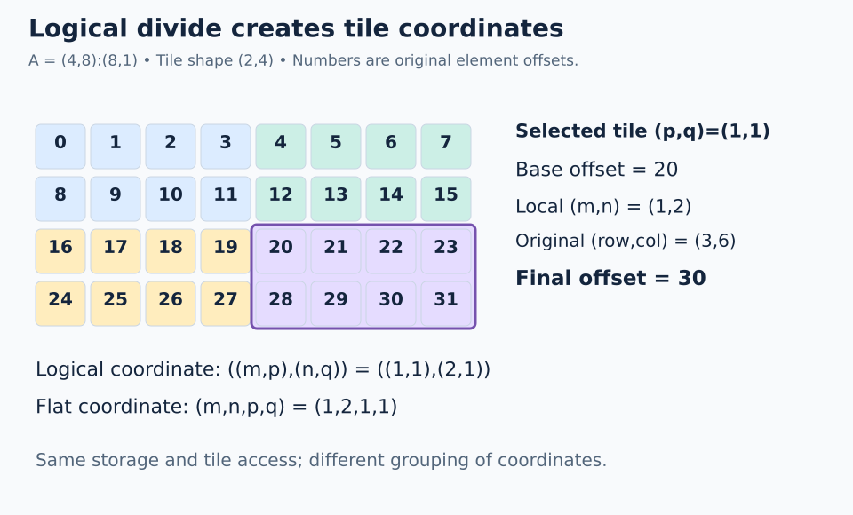

# 05 · Logical divide: expose tile windows

**Mental model from our discussion:** create windows into the original layout. Each coordinate now says both **where inside a tile** and **which tile**.

## Start in one dimension

Divide `A = 16:1` by the contiguous tiler `T = 4:1`:

```text
D = (4,4):(1,4)
D(within,tile) = within + 4*tile
```

Tile 2 names offsets `8,9,10,11`. This is a view into the original storage.

```python
# Inside a FlyDSL tracing context; A is a tensor view
divided = fx.logical_divide(A, fx.make_layout(4, 1))
tile_2 = fx.slice(divided, (None, 2))
```

`None` keeps all positions of that mode; fixing the tile number removes that mode. Slicing a tensor view carries the selected tile's base offset. A bare layout alone describes relative offsets, not the allocation base.

## Why composition appears underneath

For this contiguous example, the tiler is `T = 4:1`, and its complement within logical size 16 is `T* = 4:4`. The complement tells us how to repeat the tile.

```text
logical_divide(A,T) = composition(A, (T,T*))
```

Think **tile pattern + repetition pattern**, then pass the combined logical indices through A. General strided tilers can select noncontiguous patterns; the simple quotient formula below is for contiguous, evenly dividing tiles.

## Two dimensions: make the parentheses explicit

Take row-major `A = (4,8):(8,1)` and tile shape `(2,4)`. There are `(2,2)` tiles.



For local coordinates `(m,n)` and tile coordinates `(p,q)`:

```text
original row    = m + 2*p
original column = n + 4*q
offset = (m + 2*p)*8 + (n + 4*q)
       = 8*m + 16*p + n + 4*q
```

All four divide variants describe this same tiled access with different grouping:

| Variant | Shape | Stride | Coordinate form |
| --- | --- | --- | --- |
| `logical_divide` | `((2,2),(4,2))` | `((8,16),(1,4))` | `((m,p),(n,q))` |
| `zipped_divide` | `((2,4),(2,2))` | `((8,1),(16,4))` | `((m,n),(p,q))` |
| `tiled_divide` | `((2,4),2,2)` | `((8,1),16,4)` | `((m,n),p,q)` |
| `flat_divide` | `(2,4,2,2)` | `(8,1,16,4)` | `(m,n,p,q)` |

This refines our earlier “four dimensions” description: there are four leaf coordinates, but logical divide keeps them nested by original axis. **Flat divide** gives four top-level modes in this example. Corresponding tuple coordinates agree on offsets; using the same scalar coordinate across reordered variants need not agree.

```python
# Inside a FlyDSL tracing context
layout = fx.make_layout((4, 8), (8, 1))
logical = fx.logical_divide(layout, (2, 4))  # tuple tiler: split by mode
flat = fx.flat_divide(layout, (2, 4))

# For a tensor view A with that layout:
zipped = fx.zipped_divide(A, (2, 4))
tile = fx.slice(zipped, (None, (1, 1)))
```

Tile `(1,1)` has base offset `2*8 + 4 = 20` and relative layout `(2,4):(8,1)`. Local `(1,2)` maps to original `(3,6)`, offset `30`.

**Trap:** `fx.make_layout((2,4),(1,2))` is one layout tiler acting on a scalar domain. Passing the tuple tiler `(2,4)` requests a split of each original mode. These are not interchangeable.

## Boundaries come next

All examples here divide evenly. Real vector addition often ends with a partial tile. A divided view does not make an out-of-bounds load safe: the eventual kernel needs a suitable mask/predicate (or a separately handled tail). We will derive that with coordinate tensors.

**Check yourself:** in tile `(0,1)`, where does local `(1,3)` land? Give the logical-divide and flat-divide coordinates.

<details><summary>Answer</summary>

Original `(1,7)`, offset 15. Logical coordinate `((1,0),(3,1))`; flat coordinate `(1,3,0,1)`.

</details>

## Practice

Split `(4,8):(8,1)` into `(2,4)` tiles with native divide operations. All 32 GPU threads validate corresponding coordinates; `solve()` returns tile `(1,1)` as `[20,21,22,23,28,29,30,31]`.

Open [`practice.py`](practice.py) and complete the numbered TODOs in **`exercise_kernel()`**. All practice files start unfinished. The allocation, launch, stores, and host checker are supplied; the algebra belongs inside the kernel's FlyDSL tracing context.

### Native APIs and output

The thread index q is assigned in groups of eight per tile. Within a tile, `n` changes fastest, so the output is row-major locally. This scheduling arithmetic chooses coordinates; FlyDSL constructs and evaluates every layout.

The five output columns are flat, logical, zipped, tiled, and original-layout offsets. The checker validates every column at every position and checks that the tiles cover offsets `0..31` exactly once.

### Complete the kernel

1. Derive the flat strides on paper: `(8,1,16,4)` for `(m,n,p,tile_column)`.
2. Fill `divided` with `fx.flat_divide(original, (2,4))`. The tuple tiler splits each original mode.
3. Fill `memory_offset` with `fx.crd2idx(fx.make_coord(m,n,p,tile_column), divided)`.
4. Keep the native logical, zipped, and tiled divide checks. Their coordinates have different parentheses but must produce the same offset as the original matrix coordinate.

### Run and check

From the repository root, using the [configured GPU environment](../../README.md):

```bash
pixi run python lessons/05-logical-divide/practice.py
pixi run python lessons/05-logical-divide/solution.py
```

An unfinished starter exits with `Practice not finished: ...` during tracing. Fill each TODO with a native API expression, then rerun. A correct exercise prints `Exercise passed:` and its checkpoint. Compare with the commented [worked solution](solution.py) after your attempt.

`@flyc.kernel` traces the device computation; `@flyc.jit` traces its launch. `solve()` allocates a PyTorch GPU output, launches exactly as many threads as there are positions, synchronizes, and copies results to the host for assertions. PyTorch uses the device name `cuda` on ROCm too. These tiny launches need no tail predicate because each thread has one valid output row. General-sized launches will need bounds handling.

### Troubleshooting and another case

If the selected offsets begin `20,28,21,29`, local rows are changing fastest. If they begin `0,1,2,3`, the tile coordinate was omitted. A flat coordinate cannot be passed unchanged to logical divide. The regression check also loads from sliced tensor views to verify that slicing carries the tile base offset.

Use a scratch copy for extensions and update its launch size and expected results together. Do not replace computations with the expected constants. Static layout construction may fold during compilation; mappings depend on `fx.thread_idx.x` and are checked across the complete small domain.

[← Coalescing](../04-coalescing/README.md) · [Continue with the roadmap →](../../ROADMAP.md)
